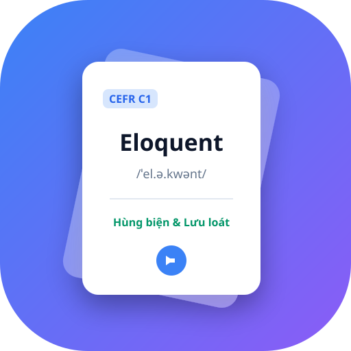

# 🃏 VocabMaster Pro - Học Tiếng Anh Flashcard Thông Minh & SRS

<p align="center">
  
</p>

<p align="center">
  <strong>Ứng dụng học từ vựng tiếng Anh qua flashcard thông minh, lặp lại ngắt quãng SRS khoa học, phát âm kép Anh-Anh (UK) & Anh-Mỹ (US), mini-games ghép thẻ/nối từ và theo dõi tiến độ học tập.</strong>
</p>

<p align="center">
  
  
  
  
</p>

---

## 🌟 Điểm Nổi Bật & Tính Năng Chính

### 🗂️ 1. Cấu Trúc 3 Tầng Khoa Học
- **Thư mục (Folders)**: Phân loại theo mục tiêu lớn (Giao tiếp, Luyện thi IELTS/TOEIC, Kinh doanh, Du lịch...).
- **Học phần (Modules)**: Mỗi thư mục chứa nhiều bài học nhỏ với thanh tiến độ hoàn thành riêng biệt.
- **Thẻ thông minh (Flashcard)**: Chứa toàn diện từ vựng, từ loại, phiên âm IPA kép, CEFR, nghĩa tiếng Việt, định nghĩa Cambridge, câu ví dụ song ngữ và ghi chú ngữ cảnh.

### ✨ 2. Tạo Thẻ Siêu Tốc 1-Chạm (Auto-Enrichment)
- **Bạn chỉ cần nhập**: `Từ vựng tiếng Anh` + `Từ loại` (Danh từ, Động từ, Tính từ...).
- **Hệ thống tự động tra cứu 100% tất cả phần còn lại**:
  - Phiên âm **IPA chuẩn UK & US** kèm âm thanh phát âm bản xứ.
  - Cấp độ từ vựng chuẩn Châu Âu **CEFR (A1, A2, B1, B2, C1, C2)**.
  - Nghĩa tiếng Việt thông dụng nhất theo chuẩn từ điển **Cambridge**.
  - Định nghĩa chi tiết tiếng Anh & Ngữ cảnh sử dụng.
  - Câu ví dụ tiếng Anh kèm dịch nghĩa tiếng Việt song ngữ.

### ⏳ 3. Phương Pháp Lặp Lại Ngắt Quãng SRS (Spaced Repetition)
- Tối ưu hóa đường cong trí nhớ Ebbinghaus với 5 chu kỳ chuẩn:
  - **Hộp 1**: 1 ngày sau
  - **Hộp 2**: 3 ngày sau
  - **Hộp 3**: 1 tuần sau (7 ngày)
  - **Hộp 4**: 1 tháng sau (30 ngày)
  - **Hộp 5**: Thành thạo vĩnh viễn (90 ngày)
- **Bộ chẩn đoán lỗ hổng kiến thức**: Tự động phát hiện và cảnh báo các từ đến hạn ôn tập hôm nay, từ hay bị quên nhiều lần và từ mới chưa học.

### 📇 4. Chế Độ Học Vuốt Thẻ Cảm Ứng (Swipe Physics)
- Chạm thẻ hoặc bấm phím `Space` để lật xem mặt trước/mặt sau.
- **Vuốt Trái 👈** (hoặc phím `⬅️`): Đánh dấu **Chưa nhớ** (Thẻ bay sang trái kèm huy hiệu đỏ, chuyển vào danh sách ôn tập khẩn cấp).
- **Vuốt Phải 👉** (hoặc phím `➡️`): Đánh dấu **Đã nhớ** (Thẻ bay sang phải kèm huy hiệu xanh, thăng cấp chu kỳ SRS).
- Phím tắt `1` để nghe giọng UK, phím tắt `2` để nghe giọng US.

### 🎮 5. Trò Chơi Học Tập Mini-Games
1. **Ghép Thẻ Trí Nhớ (Card Match)**: Lật tìm các cặp thẻ tương ứng giữa từ tiếng Anh và nghĩa tiếng Việt với đồng hồ đếm giờ và bộ đếm lượt lật.
2. **Nối Từ Siêu Tốc (Word Connection)**: Hai cột từ vựng và nghĩa tiếng Việt song song, chạm để kết nối chính xác.

### 📝 6. Bài Kiểm Tra Trắc Nghiệm Chuyên Sâu (Quiz)
- Tùy chỉnh số lượng câu hỏi (5 câu, 10 câu, 15 câu hoặc Toàn bộ).
- Định dạng câu hỏi: Trắc nghiệm 4 phương án hoặc Đúng / Sai (True/False).
- **Giải thích ngữ nghĩa chi tiết bên dưới**: Ngay khi chọn đáp án, hệ thống hiển thị toàn bộ định nghĩa, phiên âm IPA, câu ví dụ song ngữ và lưu ý ngữ pháp Cambridge.

### 📊 7. Lịch Hoạt Động (Heatmap Calendar) & Chuỗi Ngày Streak 🔥
- **Quy tắc Streak nghiêm ngặt**: Chỉ khi bạn **chính thức học xong toàn bộ thẻ của 1 học phần** thì mới được tính 1 ngày Streak.
- Lịch Heatmap theo dõi hoạt động cả năm, hiển thị số học phần đã hoàn thành, số từ đã ôn và thời gian học tập.

---

## 🚀 Hướng Dẫn Cài Đặt & Chạy Ứng Dụng

Ứng dụng được viết hoàn toàn bằng **Vanilla JavaScript thuần (Zero Dependencies)**, không cần cài đặt Node.js hay bất kỳ thư viện ngoài nào!

### Cách 1: Chạy trên Windows (Dành cho người tải về)
- **Nếu máy đã cài Python**: Nhấp đúp chuột vào file **`start_app.bat`** (hoặc phím tắt ngoài Desktop). Ứng dụng sẽ tự khởi chạy và mở trên trình duyệt tại `http://localhost:8080`.
- **Nếu máy KHÔNG cài Python**: Bạn chỉ cần nhấp đúp trực tiếp vào file **`index.html`** bằng trình duyệt bất kỳ (Chrome, Edge, Firefox, Cốc Cốc...) — ứng dụng vẫn chạy 100% mượt mà nhờ cơ chế Hybrid Storage!

### Cách 2: Chạy trên macOS / Linux
Mở Terminal tại thư mục ứng dụng và chạy:
```bash
chmod +x start_app.sh
./start_app.sh
```

### Cách 3: Mở Online Trực Tiếp Trên Điện Thoại & Máy Tính (GitHub Pages)
Khi bạn đẩy repository này lên GitHub:
1. Vào mục **Settings** của repository trên GitHub.
2. Chọn menu **Pages** ở thanh bên trái.
3. Tại mục **Branch**, chọn `main` và thư mục `/(root)` -> Nhấn **Save**.
4. Sau 1 phút, GitHub sẽ cấp cho bạn một link online vĩnh viễn:  
   `https://<ten-user-github>.github.io/<ten-repo>/`
5. Bất kỳ ai mở link này trên điện thoại iPhone hay Android đều có thể bấm **"Thêm vào Màn hình chính" (Install App PWA)** để sử dụng như một ứng dụng di động thực thụ không cần kết nối mạng!

---

## 📁 Cấu Trúc Thư Mục Dự Án

```text
english-flashcard-app/
│
├── index.html              # Giao diện chính Single Page Application (SPA)
├── manifest.json           # Cấu hình cài đặt ứng dụng PWA
├── sw.js                   # Service Worker hỗ trợ hoạt động Offline 100%
├── start_app.bat           # File khởi động nhanh 1-chạm cho Windows
├── start_app.sh            # Script khởi động cho macOS / Linux
├── launch_app.vbs          # Script khởi chạy ngầm êm ái cho Windows
├── .gitignore              # Bộ lọc bỏ qua file rác khi đẩy lên Git
├── LICENSE                 # Giấy phép mã nguồn mở MIT
├── README.md               # Tài liệu hướng dẫn sử dụng chi tiết
│
├── css/
│   └── styles.css          # Hệ thống giao diện Dark Theme chuyên nghiệp
│
├── js/
│   ├── app.js              # Controller điều phối màn hình, modal & navigation
│   ├── db.js               # Động cơ cơ sở dữ liệu IndexedDB + LocalStorage Hybrid
│   ├── dictionary.js       # Tự động tra cứu Cambridge, dịch nghĩa & CEFR
│   ├── srs.js              # Thuật toán lặp lại ngắt quãng SRS & phân tích lỗ hổng
│   ├── swipe.js            # Trải nghiệm vuốt thẻ cảm ứng Swipe Physics
│   ├── games.js            # Động cơ 2 trò chơi: Ghép thẻ & Nối từ
│   ├── quiz.js             # Động cơ bài kiểm tra trắc nghiệm cuối bài
│   ├── analytics.js        # Lịch học Heatmap Calendar & tính chuỗi Streak
│   └── audio.js            # Động cơ phát âm chuẩn UK/US & âm thanh tổng hợp
│
├── data/
│   └── sampleDecks.js      # Bộ từ vựng mẫu Cambridge phân cấp A1-C1
│
└── icons/
    ├── app.ico             # Biểu tượng Desktop Windows chất lượng cao
    ├── icon-192.svg        # Biểu tượng chuẩn PWA 192x192
    └── icon-512.svg        # Biểu tượng chuẩn PWA 512x512
```

---

## 🛠️ Công Nghệ Sử Dụng

- **Frontend Core:** HTML5 Semantic, CSS3 Custom Properties (Flexbox/Grid/Animations), Vanilla ES6+ JavaScript.
- **Data Persistence:** IndexedDB API kết hợp LocalStorage Fallback (Offline First).
- **Audio Synthesis:** Web Speech API (`en-GB` & `en-US`) + Web Audio API Synthesizer.
- **PWA Features:** Service Worker Cache, Web App Manifest, Standalone Window Mode.

---

## 📄 Bản Quyền (License)

Dự án được phân phối dưới giấy phép mã nguồn mở **MIT License**. Bạn hoàn toàn có thể tự do sử dụng, chỉnh sửa và chia sẻ cho cộng đồng.